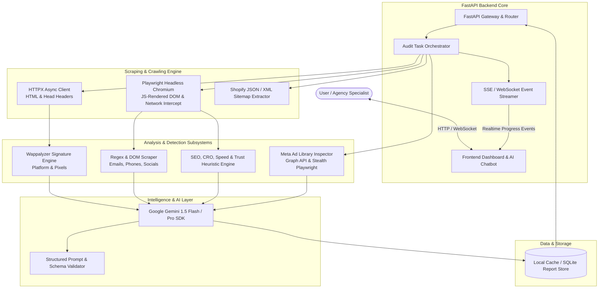
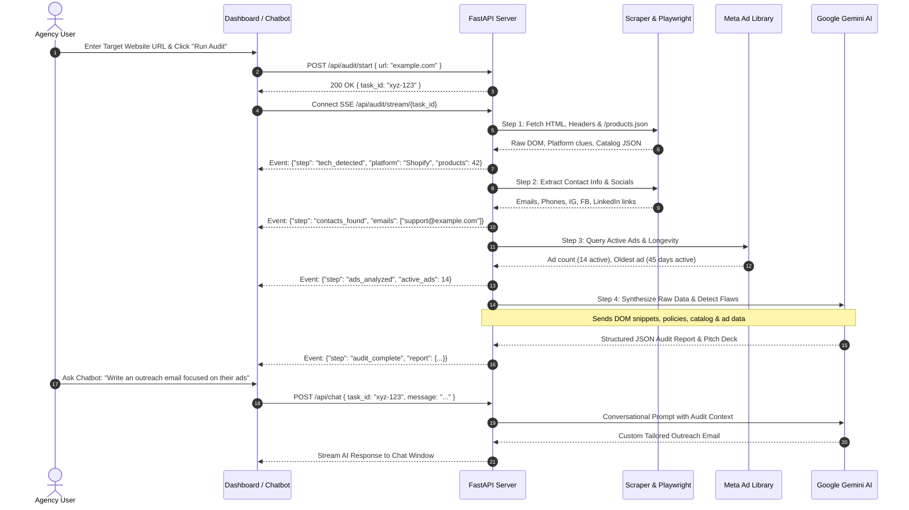

# 02. System Architecture & Tech Stack (Powered by Google Gemini)

## 1. High-Level System Architecture

The system follows a modern **Modular Asynchronous Architecture** designed for high throughput, resilient crawling, intelligent LLM reasoning, and real-time interactive user feedback.



---

## 2. Technology Stack Breakdown

### 2.1 LLM Intelligence Engine: Google Gemini
* **Model Choices:** 
  * `gemini-1.5-flash`: Used for real-time extraction, high-speed classification (Dropshipping vs. Brand), and interactive chat responses (ultra-low latency, generous free tier).
  * `gemini-1.5-pro`: Used for deep multi-page synthesis, executive SWOT analysis, and high-ticket sales pitch generation.
* **Key Gemini Features Utilized:**
  * **Structured JSON Outputs (`response_schema` / `response_mime_type="application/json"`):** Forces Gemini to return strict, typed JSON conforming to Pydantic models without markdown wrapping issues.
  * **Large Context Window (1M - 2M tokens):** Enables feeding entire raw DOM extracts, sitemaps, and policy pages simultaneously without loss of nuance.
  * **System Instructions:** Custom-crafted persona for a veteran E-commerce Conversion Rate Optimization (CRO) and Digital Marketing Agency Director.

### 2.2 Backend Framework: Python (FastAPI)
* **Framework:** `FastAPI` (Python 3.10+)
  * Async native (`asyncio`) allows running multi-threaded parallel web requests without blocking.
  * Fast serialization with `Pydantic v2` data validation.
  * Native support for Server-Sent Events (`StreamingResponse` / `EventSourceResponse`) and WebSockets for real-time progress feeds.
* **Server:** `Uvicorn` with uvloop for event loop speed.

### 2.3 Web Scraping & Crawling Stack
* **Fast HTTP Engine (`httpx` + `BeautifulSoup4` + `lxml`):**
  * Asynchronous HTTP/2 client for instant `<head>`, metadata, `/robots.txt`, and `/products.json` fetching in under 500ms.
* **Dynamic Headless Engine (`Playwright`):**
  * Chromium headless browser with stealth flags to bypass bot shields.
  * Intercepts network requests to capture live Meta Pixels, Google Analytics scripts, and dynamic JavaScript rendering.
  * Renders full mobile and desktop viewports to inspect responsive design flaws.
* **Metadata & Technology Identification:**
  * Custom signature engine matching over 150+ e-commerce platforms, CMS frameworks, analytics scripts, and review apps (Shopify, WooCommerce, BigCommerce, Magento, Wix, Webflow, Next.js, Gatsby, Klaviyo, Hotjar, TripleWhale).

### 2.4 Meta Ad Library Auditing Engine
* **Hybrid Inspection Strategy:**
  * **Primary:** Direct integration with Meta Ad Library Graph API (`/ads_archive` endpoint) using Facebook Developer access tokens for structured ad count, dates, and spend brackets.
  * **Secondary / Fallback:** Automated stealth Playwright session querying `facebook.com/ads/library/?active_status=all&ad_type=all&q={brand_name}` with DOM extraction for zero-setup execution.

### 2.5 Frontend Dashboard & Interactive Chatbot
* **Architecture:** Modern responsive single-page dashboard.
* **Styling & Aesthetics:** Premium dark-mode glassmorphism interface, CSS Grid/Flexbox layouts, Google Fonts (`Inter` & `Outfit`), glowing micro-badges, and dynamic progress bar animations.
* **Real-time Communication:** Native browser `EventSource` (SSE) for step-by-step progress notifications during live crawls + WebSocket for fluid low-latency conversational AI chatting.
* **Export Engine:** Client-side print/PDF engine and markdown download options for sending formatted proposals directly to prospects.

---

## 3. Data Flow & Component Sequence



---

## 4. Key Data Models (Pydantic Schema)

```python
from pydantic import BaseModel, Field
from typing import List, Optional

class ContactDetails(BaseModel):
    emails: List[str] = Field(default_factory=list)
    phone_numbers: List[str] = Field(default_factory=list)
    social_links: dict = Field(default_factory=dict) # {"instagram": "...", "facebook": "..."}
    address: Optional[str] = None

class TechStackInfo(BaseModel):
    platform: str # e.g. "Shopify", "WordPress", "Custom"
    hosting: Optional[str] = None
    analytics_pixels: List[str] = Field(default_factory=list) # Meta Pixel, GA4, TikTok
    apps_detected: List[str] = Field(default_factory=list) # Klaviyo, Loox, Rebuy

class FlawItem(BaseModel):
    category: str # "SEO", "Speed", "CRO", "Security", "Trust"
    title: str
    severity: str # "CRITICAL", "WARNING", "OPPORTUNITY"
    description: str
    agency_pitch_angle: str # How to sell the fix to the client

class MetaAdsInsight(BaseModel):
    active_ads_count: int
    has_active_ads: bool
    oldest_ad_days: Optional[int] = None
    ad_spend_profile: str # "Scaling", "Testing", "Inactive"
    marketing_opportunity: str

class AuditReport(BaseModel):
    url: str
    brand_name: str
    health_score: int # 0 to 100
    is_dropshipping: bool
    business_model_notes: str
    country_of_operation: str
    total_products_detected: int
    contacts: ContactDetails
    tech_stack: TechStackInfo
    flaws: List[FlawItem]
    meta_ads: MetaAdsInsight
    pitch_email_subject: str
    pitch_email_body: str
```
