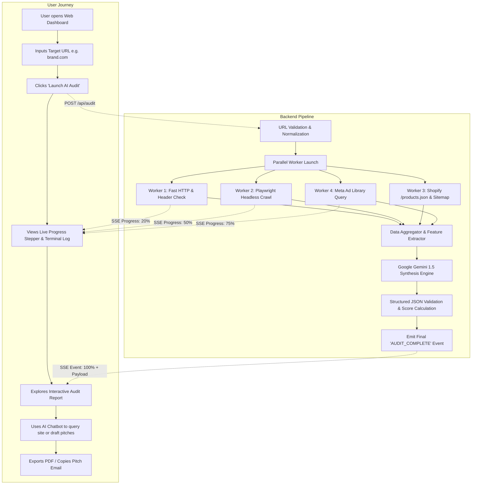

# 03. System Flow & UI Specifications

## 1. End-to-End System Flow

The workflow is split into a **Reactive Frontend Interface** and an **Asynchronous Orchestrated Backend Pipeline** communicating via Server-Sent Events (SSE) and REST/WebSockets.



---

## 2. Backend Step-by-Step Execution Flow

### Phase 1: URL Normalization & Pre-flight
1. Client sends `POST /api/audit/start` with `{ "url": "https://target-store.com" }`.
2. Backend validates URL schema, normalizes domain, verifies DNS reachability, and issues a unique `audit_id`.
3. An asynchronous task is dispatched to the background worker pool.

### Phase 2: Parallelized Data Acquisition
Four asynchronous tasks execute concurrently:
* **Task A (Fast HTTP):** Grabs initial HTML, redirects, server headers (`Server`, `X-Powered-By`), SSL validity, and response status code.
* **Task B (Playwright Headless Session):** 
  * Loads page with modern desktop user-agent.
  * Waits for `networkidle` state to capture dynamically injected pixels (Meta Pixel, Google Tag Manager).
  * Evaluates DOM for contact elements (`mailto:`, `tel:`, social icons).
  * Extracts heading hierarchy (`<h1>`, `<h2>`), meta tags, and broken links.
* **Task C (Catalog Inspection):**
  * Probes `target-store.com/products.json?limit=250`.
  * If successful (Shopify): extracts item count, price tiers, top vendors, and publish dates.
  * If unsuccessful: falls back to `/sitemap.xml` parsing.
* **Task D (Meta Ad Library Inspection):**
  * Extracts brand name from DOM / OpenGraph.
  * Searches Meta Ad Library API/Scraper for active advertisements associated with the brand page.
  * Calculates active ad count and dates of oldest running ads.

### Phase 3: AI Synthesis with Google Gemini
1. Aggregated findings (DOM excerpts, policy text, tech tags, ad counts, catalog summary) are bundled into a structured prompt.
2. Google Gemini analyzes the dataset to determine:
   * **Dropshipping vs. Brand Probability** with supporting evidence.
   * **Flaw Severity Ranking** (Critical conversion killers vs. minor improvements).
   * **Executive Health Score** (0–100 scale).
   * **Client Pitch Angles** (Customized email copy highlighting specific vulnerabilities).
3. Gemini returns validated JSON via `response_schema`.

---

## 3. UI Layout & Visual Wireframe

The interface is built as a state-of-the-art **Dark Mode Glassmorphic Dashboard** divided into logical operational zones:

```
+---------------------------------------------------------------------------------------------------------+
|  [⚡ AUDIT-AGENT AI]   |  Target: https://glowcosmetics.com  |  Status: [● AUDIT COMPLETE]  |  [⚙ Settings] |
+---------------------------------------------------------------------------------------------------------+
|                                                                                                         |
|  [ 🌐 Enter Target Website URL...                     ]   [ 🚀 Launch AI Audit ]   [ 📄 Load Demo Site ] |
|                                                                                                         |
+---------------------------------------------------------------------------------------------------------+
|  LIVE AUDIT PIPELINE                                                                                    |
|  [✓] Connect Target   [✓] Tech Stack   [✓] Contacts & Social   [✓] Meta Ads (12)   [✓] Gemini Synthesis |
|  [==============================================================================================] 100% |
+--------------------------------------------------------------------+------------------------------------+
|                                                                    |                                    |
|  SECTION A: AUDIT & INTELLIGENCE REPORT                            |  SECTION B: AI AGENT CHATBOT       |
|                                                                    |                                    |
|  +--------------------------------------------------------------+  |  +------------------------------+  |
|  | BRAND: Glow Cosmetics       | HEALTH SCORE: [ 64 / 100 ]     |  |  | 🤖 Agent Context: GlowCos... |  |
|  | PLATFORM: Shopify (Dawn)    | MODEL: [⚠️ Likely Dropshipping]|  |  |                              |  |
|  | COUNTRY: United States (USD)| CATALOG: 34 Products Detected  |  |  | "I have audited this store.  |  |
|  +--------------------------------------------------------------+  |  | They are running 12 Meta ads |  |
|                                                                    |  | but their mobile checkout    |  |
|  📊 1. TECH STACK & INTEGRATIONS                                   |  | has high friction and no     |  |
|  [ Shopify ] [ Klaviyo ] [ Meta Pixel ] [ Loox Reviews ] [ Stripe ]|  | sticky Add-to-Cart button."  |  |
|                                                                    |  |                              |  |
|  📬 2. CONTACT FOOTPRINT & SOCIALS                                 |  | [User Prompt Chips]:         |  |
|  • Email: support@glowcosmetics.com                                |  | [ ✉️ Draft Cold Pitch Email ] |  |
|  • Phone: +1 (555) 019-2834                                        |  | [ 📱 List Mobile CRO Flaws  ] |  |
|  • Social: [Instagram: @glow] [Facebook: 14k likes] [TikTok: @glow]|  | [ 🎯 3 Sales Angles to Pitch] |  |
|                                                                    |  |                              |  |
|  🎯 3. META AD LIBRARY ANALYSIS                                    |  | User: Write cold email...    |  |
|  • Active Ads: 12 Ads Running Currently                            |  |                              |  |
|  • Longest Running Ad: 68 Days (Winning Creative: Video UGC)       |  | AI: "Subject: Quick fix for  |  |
|  • Angle: "Spending ~$5k/mo on ads with slow mobile checkout!"     |  | your Glow Cosmetics checkout |  |
|                                                                    |  | Hey team, noticed you're..." |  |
|  ⚠️ 4. CRITICAL FLAWS & REVENUE LEAKS                              |  |                              |  |
|  [CRITICAL] Mobile Page Load: 4.8s (Oversized Hero Banner)         |  |                              |  |
|  [CRITICAL] Missing Sticky 'Buy Now' on Mobile Viewports           |  |                              |  |
|  [WARNING]  Missing Meta Description & Duplicate H1 Tags           |  |                              |  |
|  [WARNING]  Dropshipping Indicators: 12-20 Day Shipping Policy     |  |                              |  |
|                                                                    |  |                              |  |
|  💡 5. AGENCY PITCH RECOMMENDATIONS                                |  |                              |  |
|  1. Offer Shopify Speed Optimization to double ad ROAS.            |  |                              |  |
|  2. Redesign mobile PDP for higher checkout conversion.            |  | [Type message to AI agent...]|
|                                                                    |  |                              |  |
|  [ 📥 Export Full PDF Report ]   [ 📋 Copy Ready-to-Send Email ]    |  +------------------------------+  |
+--------------------------------------------------------------------+------------------------------------+
```

---

## 4. What We Show on UI (Screen State Transitions)

### State 1: Idle / Empty State
* Hero search bar with placeholder: `https://example-store.com`.
* Quick-demo chips (e.g., "Try Shopify Store", "Try WordPress Store", "Try Custom SaaS").
* Empty state illustration with explanation of the 5 audit pillars (Platform, Contacts, Dropshipping, Flaws, Meta Ads).

### State 2: Live Scanning / Active Pipeline
* Real-time **Animated Stepper Bar** with pulsing status rings:
  1. *Resolving Domain & Fetching HTML...* (Icon: 🌐)
  2. *Detecting Platform, Pixels & Tech Stack...* (Icon: ⚡)
  3. *Extracting Emails, Phones & Social Handles...* (Icon: 📬)
  4. *Inspecting Meta Ad Library for Active Campaigns...* (Icon: 🎯)
  5. *Synthesizing Flaws with Google Gemini AI...* (Icon: 🧠)
* Real-time console log drawer for technical transparency.

### State 3: Report Rendered (Split View)
* **Header Summary Card:**
  * Brand Name, Domain, Country flag badge, Circular Health Score gauge (Green 80+, Yellow 50–79, Red <50).
  * Business Tag: `[Brand / Private Label]` (Emerald badge) or `[Dropshipping Store]` (Amber badge) with percentage confidence.
* **Tabbed / Scrollable Audit Sections:**
  * **Tech Badges:** Visual cards for Platform, Analytics Pixels, App integrations.
  * **Contacts Drawer:** One-click copy buttons for email, phone, and direct links to Instagram, Facebook, LinkedIn.
  * **Meta Ads Card:** Ad count counter, active ad duration tag ("Running for 45+ days"), and creative breakdown.
  * **Flaws Matrix:** Color-coded cards (Red = Critical, Yellow = Warning, Blue = Opportunity) with specific agency pitch angles.
  * **Pitch Box:** Formatted cold email subject and body ready to paste into Gmail or Lemlist.
* **AI Interactive Chatbot Panel (Right Side):**
  * Persistent conversation drawer linked directly to the scanned site's JSON data.
  * Quick-prompt action buttons ("Write LinkedIn DM", "Explain Dropshipping Signs", "Create Pitch Deck Outline").
  * Instant markdown rendering of AI responses with copy buttons.

### State 4: Export & Sharing
* **Export PDF:** Clean, professional printable format removing UI chrome, perfect for attaching to sales proposals.
* **Raw JSON Export:** For integrating into agency CRM (HubSpot, Notion, Airtable).
