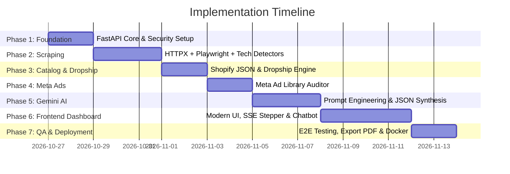

# 05. Implementation Roadmap & Execution Plan

## 1. Roadmap Overview & Timeline

This roadmap outlines a phased, production-grade approach to building the **AI-Powered Website Scraper & Lead Audit Agent** from an empty directory to a fully functioning full-stack application.



---

## 2. Phase-by-Phase Technical Tasks

### Phase 1: Project Setup & Core Security Foundation
- [ ] Initialize Python virtual environment (`venv`) and Git repository.
- [ ] Install primary dependencies: `fastapi`, `uvicorn`, `httpx`, `beautifulsoup4`, `playwright`, `pydantic`, `google-generativeai`, `python-dotenv`.
- [ ] Set up project directory structure:
  ```
  Scrapper/
  ├── backend/
  │   ├── app/
  │   │   ├── api/          # FastAPI endpoints (audit, chat, export)
  │   │   ├── core/         # Config, security, SSRF validation
  │   │   ├── scrapers/     # HTTPX, Playwright, Meta Ads
  │   │   ├── analyzers/    # Tech stack, Dropship, Flaws heuristics
  │   │   ├── ai/           # Gemini client, prompt templates, schemas
  │   │   └── models/       # Pydantic data schemas
  │   ├── tests/
  │   └── main.py
  ├── frontend/             # Single-page modern dashboard & chatbot
  │   ├── index.html
  │   ├── style.css
  │   └── app.js
  ├── .env.example
  └── requirements.txt
  ```
- [ ] Implement SSRF prevention validator (`backend/app/core/security.py`) to block private and loopback IP addresses before any network fetch.

---

### Phase 2: Web Scraping & Tech Stack Detection Engine
- [ ] Build `FastCrawler` using `httpx.AsyncClient` for rapid `<head>` tag, header, and SSL extraction.
- [ ] Install Playwright browsers (`playwright install chromium`).
- [ ] Build `HeadlessBrowserWorker` with stealth plugins to capture dynamically rendered JavaScript, meta pixels, and SPA routing.
- [ ] Implement `TechDetector`:
  - E-commerce platform signatures (Shopify, WooCommerce, BigCommerce, Magento, Wix, Squarespace, Webflow).
  - Tracking pixel detection (Meta Pixel, Google Tag Manager, GA4, TikTok Pixel, Pinterest Tag).
  - App detection (Klaviyo, Loox, Judge.me, Rebuy, Hotjar, Omnisend).
- [ ] Implement `ContactExtractor`:
  - High-precision regex for email detection (`support@`, `info@`, `hello@`, contact page forms).
  - Phone number parser with country code recognition.
  - Social profile link extractor (Instagram, Facebook, LinkedIn, Twitter/X, TikTok, YouTube).

---

### Phase 3: E-Commerce Catalog & Dropshipping Classifier
- [ ] Build `ShopifyCatalogExtractor`:
  - Probes `/products.json?limit=250` to pull instant catalog size, pricing spreads, top vendors, and newest product launches.
  - Fallback XML sitemap crawler for non-Shopify stores (`/sitemap.xml`, `/sitemap_products.xml`).
- [ ] Build `DropshippingHeuristicEngine`:
  - Analyzes shipping policy text for 7–15+ day delivery times and dropshipping fulfillment clauses.
  - Inspects review apps for imported AliExpress/unbranded photo review patterns.
  - Detects app scripts (DSers, Oberlo, Zendrop, CJ Dropshipping).
  - Scores probability: `HIGH_CONFIDENCE_DROPSHIP`, `POSSIBLE_DROPSHIP`, or `ESTABLISHED_BRAND`.

---

### Phase 4: Meta Ad Library Intelligence Integration
- [ ] Implement `MetaAdAuditor`:
  - Brand name & Facebook Page ID resolver.
  - Direct Meta Ad Library API integration using user/system token (`graph.facebook.com/v19.0/ads_archive`).
  - Fallback headless scraper targeting `facebook.com/ads/library/` in headless mode.
- [ ] Implement `AdLongevityCalculator`:
  - Computes number of active ads currently live.
  - Calculates how many days each ad has been running (identifying winning creatives active for >30–60 days).
  - Flags agency sales angle: High ad spend with a broken website = massive leak in client ad budget.

---

### Phase 5: Google Gemini 1.5 Synthesis & Conversational Agent
- [ ] Configure `google-generativeai` with `gemini-1.5-flash` and `gemini-1.5-pro`.
- [ ] Define Pydantic output schemas matching `AuditReport` for zero-shot guaranteed JSON outputs.
- [ ] Engineer master system prompts:
  - Role: Senior E-commerce Conversion Optimization & Digital Agency Strategist.
  - Task: Rank flaws by revenue impact (Critical, Warning, Opportunity).
  - Generate customized high-converting cold email pitch with concrete website observations.
- [ ] Build Conversational Agent endpoint (`/api/chat`):
  - Preserves site audit findings in conversation context.
  - Supports live follow-up prompts ("Write a LinkedIn DM", "Explain their SEO mistakes in simple terms").

---

### Phase 6: Frontend Dashboard & Interactive Chatbot UI
- [ ] Build **Modern Web UI**:
  - Dark mode glassmorphic styling, glowing badges, clean typography (`Inter`, `Outfit`).
  - Topbar with target URL input and status indicators.
- [ ] Implement **Live Progress Stepper (SSE)**:
  - Real-time animated progress bar showing each crawling step (Connecting -> Tech -> Contacts -> Meta Ads -> Gemini AI).
- [ ] Implement **Visual Audit Report Cards**:
  - Circular Executive Health Score gauge (0–100).
  - Platform & Pixel tag badges.
  - Color-coded Flaws Matrix with Agency Pitch Angles.
  - One-click copy for Contact info and Ready-to-Send Cold Email.
- [ ] Implement **Interactive AI Chatbot Sidebar**:
  - Real-time chatting with markdown formatting, code snippets, and quick action chips.
- [ ] Implement **PDF / Print Export Engine**:
  - One-click branded PDF download for attaching to sales proposals.

---

### Phase 7: Verification, Hardening & Delivery
- [ ] Test system against 5 diverse real-world test sites:
  1. A large Shopify brand (e.g. Gymshark or Allbirds).
  2. A typical dropshipping store with extended shipping and Loox reviews.
  3. A WordPress / WooCommerce local business.
  4. A custom Next.js/React SaaS platform.
  5. An edge-case site with Cloudflare bot challenges.
- [ ] Validate SSRF defenses against malicious input attempts (`http://localhost:8000`, `http://169.254.169.254`).
- [ ] Provide comprehensive `README.md` with quick-start instructions (`pip install -r requirements.txt`, `uvicorn backend.main:app --reload`).
